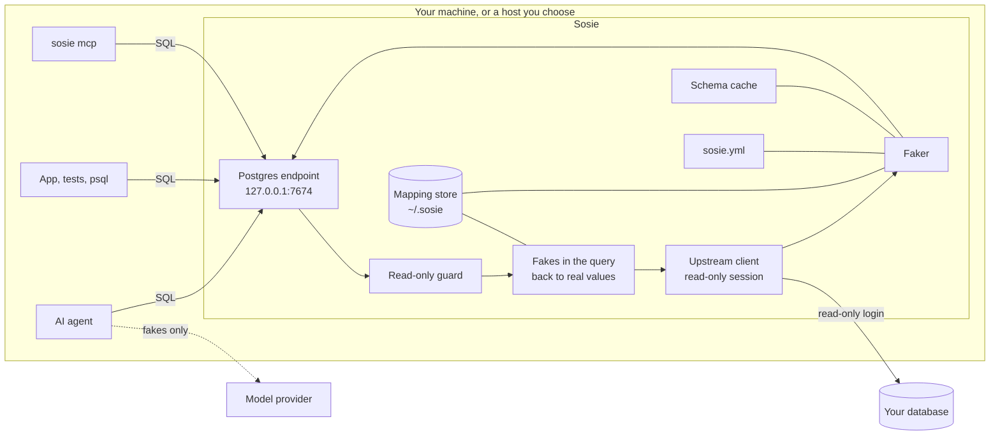

# Sosie: high-level design

Sosie is a read-only Postgres endpoint that fakes every value on the way out.
An AI agent, the developer's app and `psql` connect to it as they would to the
real database, and get the real shape with fake contents. This document covers
v0.1, the [MVP](mvp.md); the [low-level design](lld.md) has the details.

## Goals

- **The model never sees a real value**: not in query results, not in errors,
  not in what an agent echoes back.
- **Nothing to change in the client.** Anything that speaks Postgres works:
  agents, ORMs, tests, `psql`, any Postgres MCP server.
- **Code written against the fakes works on the real data.** Same types, same
  formats, same relationships.
- **No setup to start.** One command; configuration only when the defaults are
  not enough.
- **Runs where the data lives.** On the developer's machine or a host the team
  chooses. Never a hosted service.

## Non-goals (v0.1)

Writes, databases other than Postgres, REST and GraphQL, shell-output filtering,
team-shared mappings, and defending against an agent that deliberately hunts
for secrets on the machine Sosie runs on (see [Threat model](#threat-model)).

## How a developer uses it

1. In their own terminal, with the real connection string in `SOSIE_UPSTREAM`
   (or typed at a hidden prompt), they run `npx sosie`.
2. Sosie prints one local address. The agent, the app and `psql` use it.
3. Agents that prefer MCP get `npx sosie mcp`, which talks to the same
   endpoint.
4. When it matters, `npx sosie scan` checks transcripts and logs for any real
   value that passed through.
5. If a fake breaks the app's logic (a status that must be a real one), the
   team lists that column in `sosie.yml` and commits it.

## Architecture



| Component | Job |
| --- | --- |
| Postgres endpoint | Speaks the Postgres wire protocol on 127.0.0.1, simple and extended query |
| Read-only guard | Parses each statement; allows reads, refuses everything else and a short list of catalogs that hold real values |
| Rewriter | Turns fakes the client sends (literals and parameters) back into real values |
| Upstream client | One read-only session to the real database, with a timeout and a row cap |
| Schema cache | Tables, columns, types, enums and foreign keys, read once at start |
| Faker | Turns each result value into its fake, by column, type and rule |
| Mapping store | Remembers each fake for each real value, so fakes are consistent and reversible |
| `sosie mcp` | MCP server with `describe` and `query`, a client of the endpoint |
| `sosie scan` | Finds real values in files, using the store's keyed hashes |

## A query, end to end

```mermaid
sequenceDiagram
  participant C as Client (agent, app, psql)
  participant S as Sosie
  participant D as Database
  C->>S: SELECT * FROM users WHERE email = 'kim@example.net'
  S->>S: guard: a read, allowed
  S->>S: rewrite: 'kim@example.net' is the fake of a real email
  S->>D: SELECT * FROM users WHERE email = (the real email)
  D-->>S: rows, with each column's table and position
  S->>S: fake every value; the same real value, the same fake
  S-->>C: rows of fakes
```

## The faking model

- **Fake by default.** Every value is faked by its column's type. A value passes
  unchanged only when `sosie.yml` lists its column.
- **Consistent.** A real value in a column always becomes the same fake. A
  foreign key fakes like the key it points to, so `orders.user_id` matches
  `users.id`.
- **Realistic.** The fake has the column's type and, where the column's name
  says so, a realistic format: emails, names, phone numbers, addresses. The name
  only picks the format; it never lets a value pass.
- **Reversible inside Sosie only.** The store maps fakes back to real values so
  queries by a fake work. Real values are sealed in the store and never leave
  Sosie's process.
- **Schema first, detection last.** The database's schema says what each value
  is. Automatic detection is not in v0.1; when it comes, it will only suggest
  rules for the team to review.

## Threat model

**Sosie protects against** real values reaching a model through normal agent
work: query results, error messages, a query echoed back with real values
substituted, and transcripts kept afterwards.

**Sosie does not protect against, in v0.1:**

- **An agent hunting for secrets on the same machine.** An agent runs as the
  developer's user, so it can read files and processes that user can. Run
  Sosie on another host, with the credentials only there, and give the agent
  only Sosie's address.
- **Inference through filters.** A query filters on real data, so a careful
  sequence of queries can answer yes-or-no questions about it.
- **Shape.** Row counts, which values are null, and the rough size of values are
  visible.

The defaults narrow the rest: a read-only login and session, a statement
timeout and a row cap protect the database; errors are scrubbed of anything Sosie
substituted; catalogs that store real values (such as `pg_stats`) are refused.

## Decisions

| Decision | Why | Alternatives |
| --- | --- | --- |
| Speak the Postgres protocol | One endpoint serves agents, apps, tests and any Postgres MCP server | An MCP-only server serves agents, not the app or its tests |
| Read the live database | No copy to store, refresh or leak | Dump-and-mask tools ([Greenmask](https://greenmask.io), [Tonic Structural](https://www.tonic.ai)) work on a copy that goes stale |
| Need nothing installed upstream | A read-only login is all the team grants | [PostgreSQL Anonymizer](https://postgresql-anonymizer.readthedocs.io) masks inside the database, which needs an extension and roles there |
| Fake, not redact | Code needs valid values to run; blanks and tokens break it | Redaction gateways between an agent and a model provider see text, not columns |
| TypeScript on Node 22, `npx` | One command, no install; the language of most agent tooling | A Go binary installs well but loses `npx` |
| A local mapping store | Consistent fakes across sessions, and queries by a fake | Format-preserving encryption needs no store but cannot give realistic emails or names |

## Risks

- **Driver coverage.** The extended query protocol and binary formats vary
  between drivers. v0.1 is tested with `psql` and `node-postgres`; Prisma and
  Drizzle before release.
- **Computed values.** A value a query computes (`length(email)`) has no
  column, so it is faked by type, which can surprise. `count(...)` passes.
- **The store holds sealed real values** on the machine Sosie runs on. It is
  readable by that machine's user; the threat model says where to run Sosie when
  that matters.
