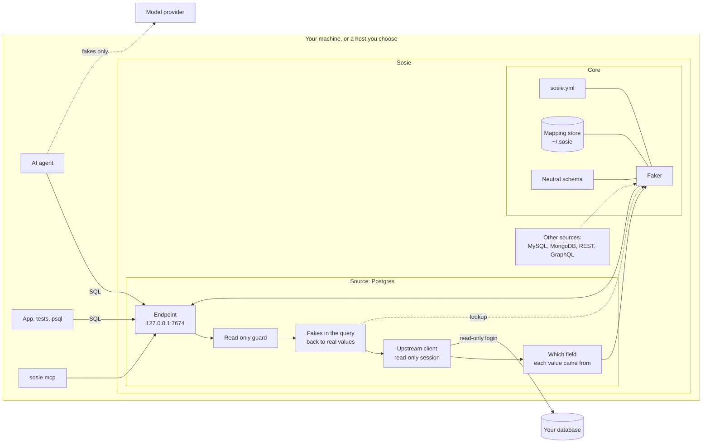

# Sosie: high-level design

Sosie is a read-only endpoint in front of a data source that fakes every value
on the way out. An AI agent, the developer's app and their tools connect to it
as they would to the real source, and get the real shape with fake contents.
Postgres was its first source, the [MVP](mvp.md); the team's own REST and
GraphQL APIs came next, and v0.1, the first release, has all three; MySQL followed, then MongoDB. More are packages
behind the same interface. A
[plugin](#the-plugin) brings Sosie's MCP server, and how to read through it, to the agent's assistant. The
[low-level design](lld.md) has the details.

## Goals

- **The model never sees a real value**: not in query results, not in errors,
  not in what an agent echoes back.
- **Nothing to change in the client.** Anything that speaks the source's
  protocol works. For Postgres: agents, ORMs, tests, `psql`, any Postgres MCP
  server.
- **Built to grow.** A new database or API is a new source package; the core,
  which decides every fake, does not change.
- **Code written against the fakes works on the real data.** Same types, same
  formats, same relationships.
- **Little setup, in one place.** `sosie.yml` says which sources a project has, and the first run writes it with
  the first; one command then starts them all. Nothing else configures Sosie: no flags, no variables of its own.
- **Runs where the data lives.** On the developer's machine or a host the team
  chooses. Never a hosted service.

## Non-goals

Writes, databases beyond those [planned](#how-sosie-grows), an endpoint that
imitates Oracle's own protocol, third-party APIs (for now), shell-output
filtering, team-shared mappings, and defending against an agent
that deliberately hunts for secrets on the machine Sosie runs on (see
[Threat model](#threat-model)).

## How a developer uses it

1. In their own terminal, in the project's folder, they run `npx @sosie/cli`. The first time, it asks for the first
   source's connection string at a hidden prompt, names the source, and writes a `sosie.yml` that says where to find
   the string next time, `${SHOP_URL}`, never the string itself. The team commits it, and adds any other source, a
   database or an API, under `sources:`.
2. One Sosie serves every source of the project, each at a local address of its own, which it prints. The agent, the
   app and `psql` use them.
3. Agents that prefer MCP get `npx @sosie/cli mcp`, which talks to the same
   endpoints. The plugin installs it in the assistant, with a skill that says how to read through Sosie, and, in
   Claude Code, Copilot CLI and VS Code, tells each session which Sosies run.
4. When it matters, `npx @sosie/cli scan` checks transcripts and logs for any real
   value that passed through.
5. If a fake breaks the app's logic (a status that must be a real one), the
   team lists that column in `sosie.yml` and commits it.

## One Sosie, every source

A project often reads more than one upstream: two databases, a REST API, a GraphQL one. One Sosie serves all of
them, and every source is set up the same way, in one file: `sosie.yml`, in the folder Sosie starts in, is the only
configuration there is. A setting has one place, so there is never a question of which of two wins.

```yaml
max-rows: 1000           # for every source; a source may set its own
pass: [orders.status]    # for every source that has the table

sources:
  shop:
    upstream: ${SHOP_DATABASE_URL}
  billing:
    upstream: ${BILLING_API_URL}
    headers:
      Authorization: Bearer ${BILLING_TOKEN}
    schema: ./openapi/billing.yaml
```

- **A source is a name and the same few keys,** whatever it reads: `upstream`, and where needed `kind` (when its URL
  does not say), `schema` (a file or URL describing an upstream that cannot describe itself), `headers`, `port`, and
  its own rules. A key a source cannot use is an error that says so. A new kind of source takes the same keys.
- **Credentials only through the environment.** A `${NAME}` is read from the terminal Sosie starts in, or asked for
  at a hidden prompt; the names are the team's own. `upstream` is always one whole variable, so a file the agent can
  edit never sends the developer's credentials to a host it chose; Sosie refuses one written out.
- **One process.** Every source connects before any serves; one that cannot stops Sosie, naming it. Each listens on
  its `port`, or the next free from 7674 in the order listed, and Ctrl+C stops them all.
- **Rules at the top hold for every source that has the table.** Fields keep their names, so a person is one fake in
  every source, and adding a source never changes another's fakes.

## Architecture

Sosie is a **core** that knows nothing about any database or API, and
**sources** that each know one kind of upstream: Postgres, MySQL, MongoDB, and
the team's REST and GraphQL APIs. A source speaks its upstream's protocol to clients and reports which
field each value came from; the core decides every fake.



| Part | Component | Job |
| --- | --- | --- |
| Core | Neutral schema | Entities, fields, types, keys and references, the same shape for every source |
| Core | Rules | `sosie.yml`, checked against the neutral schema: what passes, which format |
| Core | Faker | Turns each value into its fake by field, type and rule; looks fakes up for queries |
| Core | Mapping store | Remembers each fake for each real value, so fakes are consistent and reversible |
| Core | `sosie mcp` | MCP server: `describe` from the core, plus each source's tools |
| Core | `sosie scan` | Finds real values in files, using the store's keyed hashes |
| Postgres | Endpoint | Speaks the Postgres wire protocol on 127.0.0.1, simple and extended query |
| Postgres | Guard | Allows reads; refuses everything else and the catalogs that store real values |
| Postgres | Rewriter | Asks the core for the real value behind each fake in a query |
| Postgres | Upstream client | One read-only session per client, with a timeout and a row cap |
| Postgres | Results | Names the field of each result column, from the table and position Postgres reports |
| MySQL | Endpoint | Speaks MySQL's protocol on 127.0.0.1: statements as text, several to a query, and prepared statements |
| MySQL | Guard | MySQL's dialect of sqlparser: allows reads; refuses everything else, and the tables and settings that hold queries, password hashes or where the database is |
| MySQL | Rewriter and results | Turns back the literals compared with a column, in place; names each result column's field from the database, table and column MySQL reports |
| MongoDB | Endpoint | Speaks MongoDB's wire protocol on 127.0.0.1, as a standalone server that takes no login; answers the handshake itself |
| MongoDB | Guard | Allows read commands by name, and a pipeline's stages by name; refuses writes, JavaScript on the server, stages that write or show other sessions, and MongoDB's own databases |
| MongoDB | Shapes, rewriter and faking | Reads where each value of a result comes from out of the find or the pipeline, stage by stage; turns back fakes compared by equality; fakes each value in its own BSON type |
| REST | Endpoint and guard | The API's paths on a local HTTP address; `GET` and `HEAD` only, with Sosie's credentials |
| REST | Fields | Names each value's field from the OpenAPI document, or from where it sits |
| REST | Links | Points the API's links at Sosie, with nothing real in them, and reads them back |
| GraphQL | Endpoint and guard | The API's path on a local HTTP address; queries only, checked with their variables against the schema |
| GraphQL | Introspection | Answered from the schema Sosie holds; it never reaches the API |
| GraphQL | Fields | Names each value's field from the schema, through aliases, fragments, interfaces and unions |
| Plugin | MCP server | `sosie mcp`, at the CLI version released with the plugin |
| Plugin | Skill | How to read through Sosie: the tools, what a fake means, why a result can look wrong, and never to start Sosie or touch its credentials |
| Plugin | Hooks: Claude Code, Copilot CLI, VS Code | At a session's start, which Sosies run; at its end, or each turn's in VS Code, `sosie scan` on its transcript, reported at the next start |

## How Sosie grows

A source is a package with one interface: it connects to its upstream
read-only, describes it in the neutral schema, serves an endpoint, and hands
every value to the core. Rules, fakes, the store, `scan` and `describe` stay the
same for every source.

| Order | Source | Why then |
| --- | --- | --- |
| First, the MVP | Postgres | Most personal data lives in databases, and teams least dare give an agent access to them |
| Next, also in v0.1 | REST and GraphQL, the team's own APIs | They mostly serve the same data, and format domains keep a person the same fake in both |
| v0.2 | MySQL | The other database most teams run; its result metadata names each value's column, as Postgres's does |
| After v0.2 | MongoDB | The most used database after the SQL ones, above all with the JavaScript developers `npx` reaches; its protocol is open, and its commands are documents, so its guard needs no parser |
| Next | SQL Server, and Azure SQL with it | The database of most .NET and Microsoft teams. Its protocol is open but the largest yet, and its clients encrypt by default |
| Only on demand, and through MCP | Oracle | Its protocol is closed, and its results do not say which table a column came from, so it would be the one source that apps and tests cannot connect to unchanged |
| Later | MariaDB; third-party APIs | On demand; many third-party APIs already offer a test mode |

The core is tested through an in-memory test source, without Postgres, so
nothing in it can come to depend on one source.

### The next databases

After Postgres and MySQL, the most used databases are Oracle, SQL Server and MongoDB. A source for each is three
questions: can clients connect to Sosie unchanged, can Sosie be sure a request only reads, and can it tell which
field each value came from.

| | MongoDB | SQL Server | Oracle |
| --- | --- | --- | --- |
| For clients | Its wire protocol, open: `OP_MSG` and BSON, with the first `hello` as `OP_QUERY`. The Node driver, which Mongoose is built on, connects unchanged and is tested; `mongosh` was checked by hand; Compass and MongoDB's own MCP server are not checked yet. FerretDB shows a server of its own can satisfy them | TDS, open ([MS-TDS](https://learn.microsoft.com/openspecs/windows_protocols/ms-tds/)): login, batches, and RPC, which every driver uses for parameters (`sp_executesql`). ODBC Driver 18, JDBC and SqlClient encrypt by default, so the endpoint needs TLS from the start, carried in TDS's own packets | TNS and TTC: closed, known only from Oracle's own thin drivers. Sosie would have to imitate Oracle's logon and whatever each client checks: JDBC, OCI, ODP.NET |
| Read-only | Commands are documents, allowed by name: `find`, `aggregate` without `$out` or `$merge`, `count`, `distinct`, the `list` commands. Server-side JavaScript (`$where`, `$function`, `$accumulator`) is refused. A login with the built-in `read` role is the layer under it | sqlparser's T-SQL dialect reads the usual reads (`TOP`, `CROSS APPLY`, `FOR JSON`); what it cannot parse is refused, as with MySQL. Writes hide in `SELECT INTO`, `EXEC`, `OUTPUT`, `OPENROWSET` and linked servers. SQL Server has no read-only session, so the login's grants (`db_datareader`, no `EXECUTE`) are the only layer under the guard | sqlparser's Oracle dialect reads the usual reads (`ROWNUM`, `CONNECT BY`, `(+)` joins). `SET TRANSACTION READ ONLY`; database links, `UTL_` and `DBMS_` packages refused |
| Field of a value | No schema to read: the collection and the dotted path (`users.address.city`), as the REST source learns a body without a document, and `$jsonSchema` validators where a collection has them. `find` keeps paths; what an aggregation renames is read from its pipeline, and what it computes is faked by type. A fake in a filter is a value in a document, turned back with no parse | Results name only the column. Browse mode, or `sp_describe_first_result_set` with browse information, names its database, table and column through views and aliases, as MySQL's metadata does | Oracle names no table for a result column, so every column would rest on the parse, and anything it cannot place would be faked by type |
| Size | Medium. The protocol is small and needs no parser, but documents are new to the core, and ObjectId a type of its own. Decimal128 and dates fit the types it had | Large: the Postgres source's size, with TLS and RPC from the first day | Very large and brittle as an endpoint; medium as an MCP-only source |
| Tested on | `mongodb-memory-server`, as MySQL is on `mysql-memory-server` | SQL Server's container, x86 only: Rosetta on Apple silicon | Oracle Database Free's container, large and slow to start |

So MongoDB comes first: it fits Sosie best, and gives the guard least room to be wrong. SQL Server follows, the same
kind of source as Postgres and MySQL, only bigger. Oracle, if ever, comes as an MCP-only source: `describe` and
`query`, with node-oracledb's Thin mode upstream. Agents could use it; apps and tests could not.

Each starts with a spike before it is planned in detail. MongoDB's showed the drivers and `mongosh` take a server of
Sosie's own, and that an ObjectId needs a type of its own in the core, faked in one domain wherever it is held; it is
built (see the [low-level design](lld.md#mongodb-source)). For SQL Server: TLS with each driver's defaults, and which
metadata names the column.

## The plugin

A source widens what Sosie can read; the plugin widens where agents find it. It is Sosie's MCP server and a skill,
in the open [Agent Plugins](https://agent-plugins.org) format, so one install serves Claude Code, GitHub Copilot,
VS Code, Cursor, Codex, Kiro and Devin. The repository is its marketplace.

- **The skill** tells the agent what it would otherwise learn by surprise: every value is a fake, a fake it saw finds
  its record, order and partial matches follow the real data, and Sosie is started by the developer, never by the
  agent.
- **The hooks**, in Claude Code, Copilot CLI and VS Code, close the loop the MVP left to the developer. A session
  starts knowing which Sosies run, or, in a project with a `sosie.yml` and none running, that it should ask for one.
  When it ends, `sosie scan` checks its transcript, and the next session reports a real value it found. The hooks
  run the proof; what a shell prints is still not filtered. Agent Plugins has no place for hooks, so each assistant
  reads its own file, and all of them run the same scripts.

The plugin is a client of Sosie like any other. It starts no Sosie and holds no credentials: the connection strings
are in the developer's terminal, where the agent cannot read them.

## A query, end to end

```mermaid
sequenceDiagram
  participant C as Client (agent, app, psql)
  participant S as Sosie
  participant D as Database
  C->>S: SELECT * FROM users WHERE email = 'kim@example.net'
  S->>S: guard: a read, allowed
  S->>S: rewrite: 'kim@example.net' is the fake of a real email
  S->>D: SELECT * FROM users WHERE email = (the real email)
  D-->>S: rows, with each column's table and position
  S->>S: fake every value; the same real value, the same fake
  S-->>C: rows of fakes
```

## The faking model

- **Fake by default.** Every value is faked by its column's type. A value passes
  unchanged only when `sosie.yml` lists its column.
- **Consistent.** A real value in a column always becomes the same fake. A
  foreign key fakes like the key it points to, so `orders.user_id` matches
  `users.id`.
- **Realistic.** The fake has the column's type and, where the column's name
  says so, a realistic format: emails, names, phone numbers, addresses. The name
  only picks the format; it never lets a value pass.
- **Reversible inside Sosie only.** The store maps fakes back to real values so
  queries by a fake work. Real values are sealed in the store and never leave
  Sosie's process.
- **Schema first, detection last.** The database's schema says what each value
  is. Automatic detection is not built; when it comes, it will only suggest
  rules for the team to review.

## Threat model

**Sosie protects against** real values reaching a model through normal agent
work: query results, error messages, a query echoed back with real values
substituted, links an API returns, and transcripts kept afterwards.

**Sosie does not protect against:**

- **An agent hunting for secrets on the same machine.** An agent runs as the
  developer's user, so it can read files and processes that user can. Run
  Sosie on another host, with the credentials only there, and give the agent
  only Sosie's address. The plugin's skill tells the agent never to look for
  them; that is advice a working agent follows, not a wall.
- **Inference through filters.** A query filters on real data, so a careful
  sequence of queries can answer yes-or-no questions about it.
- **Decoding by comparison.** A value a query computes is faked consistently,
  so an agent set on it can compute fakes of values it chose (`chr(65)`) beside
  fakes of real ones (`substr(email, 1, 1)`) and match them. Like filters, this
  takes a deliberate sequence of queries, not normal work.
- **Shape.** Row counts, which values are null, and the rough size of values are
  visible.
- **Who can reach the endpoint.** It has no password. On 127.0.0.1, only this
  machine can, and an HTTP endpoint answers only requests addressed to
  localhost, and from no page of another site, so a web page can neither
  rebind its name to it nor make it send a request; on another `host`,
  anyone who reaches that address can query the fakes and filter on the real
  values.
- **An API's own structure and behaviour.** Its paths, its base path (in
  Sosie's address), its OpenAPI document or GraphQL schema with their
  descriptions, and its status codes are visible: they are the API, not values
  from it. A `GET`, or a GraphQL query field, that writes is the API's to
  guard; Sosie sends every `GET` and every query on.
- **What the team lets pass, and keys that look like structure.** A field
  listed under `pass` shows its own values: Sosie hides in it only what the
  request turned back and its own credentials. Without an API's document, a
  map keyed by lowercase words (`{ "jdoe": … }`) keeps its keys, as a json
  column's or a JSON scalar's do. The LLD's limits list each such case.
- **An edited `sosie.yml`.** The file is committed, and an agent can edit it: a field it adds under `pass` shows
  real values once the developer starts Sosie again. Sosie never lets the file hold a credential, nor send one to a
  host it names, and each start prints every source's host and the fields that pass; the team reviews the file as it
  reviews code.
- **Fakes crossing sources.** One store serves every source, so a fake from
  the database typed into an API request turns back into its real value, which
  goes to that API. It never reaches the client.
- **The schema and the server.** Table and column names, the definitions of
  views and functions, the names of the server's databases and roles, the server's version and most of
  its settings are visible: drivers and agents need them, and they are not
  values from your tables. A literal written into a view or function, such as
  a hard-coded address, is visible with it. Settings that say
  where the database is (its address, port, files, replication source) are
  refused.

The defaults narrow the rest: a read-only login and session, a statement
timeout and a row cap protect the database; errors are scrubbed of anything Sosie
substituted; catalogs that store real values (such as `pg_stats`) are refused.

## Decisions

| Decision | Why | Alternatives |
| --- | --- | --- |
| A source-agnostic core, with sources as packages behind one interface | Adding MySQL or an API is a new package, not a change to the core | Postgres wired into the core: quicker for v0.1, and the second source would mean a rewrite |
| A neutral schema between sources and the core | Rules, domains and fakers are written once, for every source | Each source with its own rules and fakers: duplicated, and inconsistent across sources |
| Speak each upstream's own protocol to clients | One endpoint serves agents, apps, tests and any MCP server for that database | An MCP-only server serves agents, not the app or its tests |
| Oracle, if ever, through MCP only | Its protocol is closed, each client checks the server its own way, and its results name no column's table | An endpoint that imitates Oracle: large, brittle, and every column faked from the parse alone |
| Read the live database | No copy to store, refresh or leak | Dump-and-mask tools ([Greenmask](https://greenmask.io), [Tonic Structural](https://www.tonic.ai)) work on a copy that goes stale |
| Need nothing installed upstream | A read-only login is all the team grants | [PostgreSQL Anonymizer](https://postgresql-anonymizer.readthedocs.io) masks inside the database, which needs an extension and roles there |
| Fake, not redact | Code needs valid values to run; blanks and tokens break it | Redaction gateways between an agent and a model provider see text, not columns |
| TypeScript 7 on Node 26, run with `npx` | One command, no install; the language of most agent tooling. Node 26 is the LTS line from 28 October 2026; Node 24 is still allowed | A Go binary installs well but loses `npx` |
| A local mapping store | Consistent fakes across sessions, and queries by a fake | Format-preserving encryption needs no store but cannot give realistic emails or names |
| One plugin in the open Agent Plugins format, from this repository's own marketplace | One install gives the agent the tools and how to use them, in every assistant that reads the format; the CLI stays the one thing to run | `claude mcp add` alone: the tools without the skill, one assistant at a time. A plugin per assistant: the same files, kept in step by hand |
| The plugin starts no Sosie | The connection string stays in the developer's terminal, out of the agent's reach | An MCP server that starts Sosie when asked: the agent's own process would hold the credentials |
| One Sosie serves every source of a project | One command, one terminal, one list of addresses; rules and fakes shared by every source | A Sosie per upstream: a terminal each, and a `sosie.yml` that every one of them must read as its own |
| `sosie.yml` is the only configuration | One place for every setting: nothing to decide between a flag, a variable and the file | Flags and variables beside the file: each setting in two places, and a rule for which wins |
| Credentials only as `${VAR}`, `upstream` one whole variable | The file is committed, and an agent can edit it: no secret is written in it, and no edit sends one elsewhere | Strings in the file: secrets in git. A host written out beside a password from the environment: an edit sends the password to another host |

## Risks

- **MySQL's parser is not MySQL's.** Postgres's guard reads statements with Postgres's own parser; MySQL has none
  outside the server, so its guard reads them with sqlparser's MySQL dialect. What it cannot parse is refused, valid
  MySQL included. A column MySQL names a table for is faked by that, whatever the parse; a column it names none for
  (anything computed, and a `UNION`'s) rests on the parse, which reads what it cannot place, an unknown function or
  table, as data. A statement read differently from MySQL could still be let through, or a value computed from
  rows passed: the session's read-only start, the login's grants and the result metadata are the layers under it.
  Where several statements in a query end, and where a prepared statement's parameters are, rest on the parse too,
  each with MySQL's check under it: each piece goes upstream alone, on a session that runs one statement per query,
  and MySQL's count of parameters must be the guard's.
- **MongoDB says nothing of where a value came from.** Postgres's and MySQL's metadata name each column's table and
  column; MongoDB's answers name nothing. So every value rests on Sosie's reading of the command: a find's documents
  are its collection's, and a pipeline is read stage by stage, a stage it does not know refused. What it cannot place
  (anything a stage computes) is faked by its type, and in what a stage computes, a key is faked unless the client
  wrote it. A pipeline read differently from MongoDB could still let a value through in a field Sosie took for
  another: the login's `read` role and the refused stages are the layers under it.
- **Driver coverage.** The extended query protocol and binary formats vary
  between drivers. Sosie is tested with `psql`, `node-postgres`, `postgres.js`,
  Drizzle and Prisma 7; its binary format byte for byte against Postgres's
  own, and by hand with asyncpg and pgJDBC. pgx is not checked yet. A type
  Sosie cannot write in binary from its text (`regclass`, `money`, composites, ranges)
  is refused in binary, with an error that names it.
- **Computed values.** A value a query computes (`length(email)`) has no
  column, so it is faked by type, which can surprise. `count(...)` passes.
- **Real order.** Sorting and ranges run upstream, on the real values, so
  fakes come back in an order of their own.
- **The store holds sealed real values** on the machine Sosie runs on. It is
  readable by that machine's user; the threat model says where to run Sosie when
  that matters.
- **The plugin follows the CLI.** It runs `@sosie/cli` at its own version, so each release moves both, and a test
  fails until it does. Its hooks lean on each assistant's own, which differ and change: Claude Code gives a
  session-end hook 1.5 seconds and shows nothing, Copilot CLI does not say where the transcript is, and VS Code has no
  session end at all. So the scan runs on its own and reports at the next session's start.
